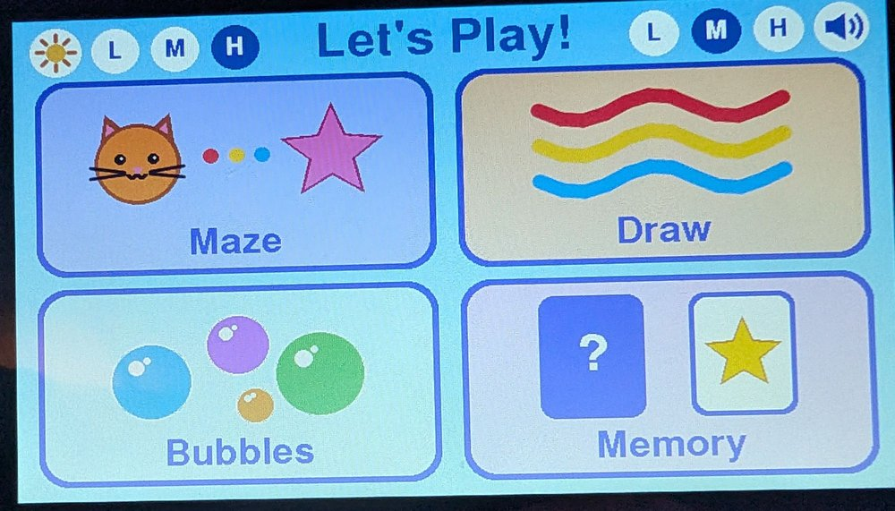
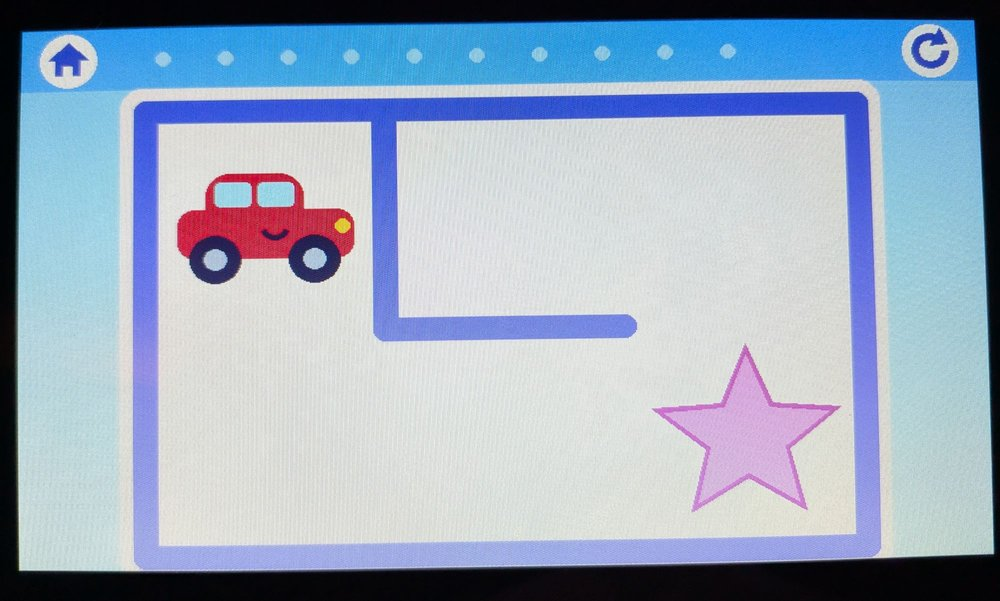
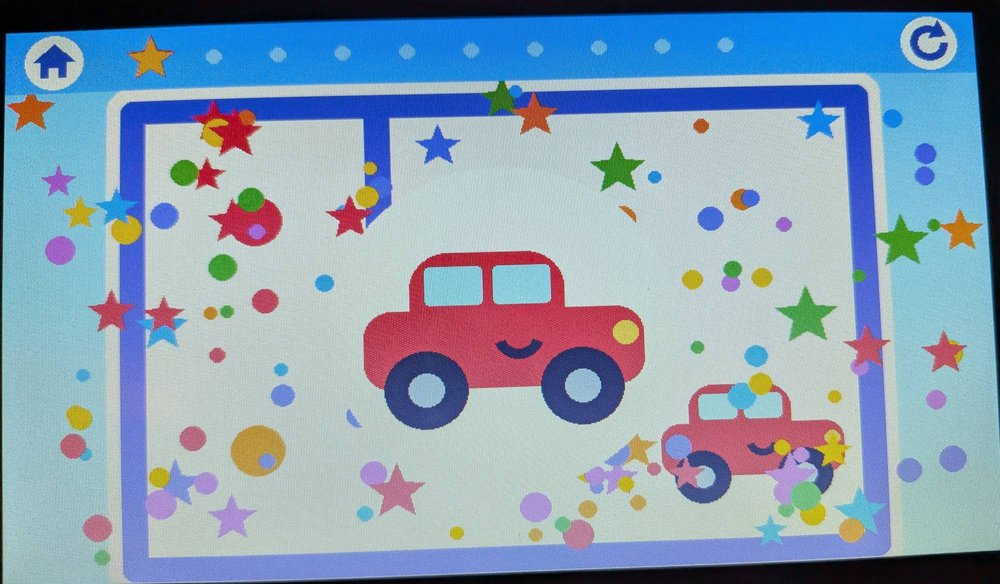

# CrowPanel 7" Kids Games

Simple touchscreen games for toddlers (made for a 3-year-old), running on the
**Elecrow CrowPanel 7.0 (basic)** ESP32-S3 display. No reading needed: big
pictures, big touch targets, and a confetti party for every win.



| Maze | Reaching the star |
|---|---|
|  |  |

## Games

A home screen with four big tiles. A house button (top left) in each game goes back home.

- **Maze**: drag the character to the pink star. The cat, car and dino take turns,
  gliding from square to square and leaving a rainbow trail. Mazes start tiny (3×2)
  and grow to 6×4. Movement is forgiving: the character follows the finger if it's
  up to two squares ahead along the path. Each win adds a gold star at the top.
- **Draw**: finger painting with 7 rainbow colors, dark, and an eraser. The
  round-arrow button clears the page. The **camera** button saves the picture
  (a green check means it's saved), and the **picture-frame** button opens the
  gallery of saved drawings, newest first. Tap one to keep drawing on it, or the
  arrow to go back. To delete one, tap the **X** in its corner (it turns red),
  then tap it again within 3 seconds. See [Saved drawings](#saved-drawings) for
  where they're kept.
- **Bubbles**: colorful bubbles float up; touch them to pop. Drawn off-screen
  first, so there's no flicker.
- **Memory**: flip two cards to find a match (star, cat, car, dino, heart, ball).
  Switches between 3 and 4 pairs.

## Saved drawings

Without a card, the board keeps up to **6** drawings in its own flash. With a
**microSD card** in the slot, it keeps up to **60** on the card, and the gallery
gets page arrows (6 drawings per page). Saving past the limit drops the oldest.

- Use a card formatted **FAT32** (most cards up to 32 GB come that way).
- Drawings already saved in flash move onto the card the first time it's used.
- The card can go in or come out any time. The board checks for it when you
  save or open the gallery.
- Drawings are in the `kidsdraw` folder on the card. They're stored in a small
  custom format (`.kd`), not as images.
- Drawings in flash survive unplugging and reflashing.

SD slot: SPI on GPIO 10 (CS), 11 (MOSI), 12 (SCK) and 13 (MISO).

## Brightness and screen sleep

At the top left of the home screen, the sun icon and **L / M / H** set the screen
brightness. It's remembered after the board is unplugged.

With no touches, the screen dims after **2 minutes** and turns off after
**5 minutes** (the games pause while it's dark). A touch brings it back: on a
dimmed screen the touch works as normal, and the tap that wakes a dark screen
is ignored so nothing gets pressed by accident. Change `DIM_AFTER_MS` and
`OFF_AFTER_MS` in `src/main.cpp` for different timings.

## Sound

Plug a small speaker (4–8 Ω, around 1–3 W) into the board's **SPK** connector.
Sounds are generated in code (no audio files): a startup chime, a little tune as
the maze character steps, a happy jingle for every win, bubble pops (big bubbles
pop lower), card flips, a match chime, and taps on buttons.

At the top right of the home screen, **L / M / H** set the volume (Low, Medium,
High) and the **speaker button** turns sound on and off. Both settings are
remembered after the board is unplugged. Without a speaker
everything works the same, just silently.

Speaker connector: NS4168 I2S amplifier on GPIO 17 (data), 18 (LRCLK) and 42 (BCLK).

## Hardware

This is for the **basic CrowPanel 7.0**, not the CrowPanel **ADVANCE** 7.0.
They look alike but use different modules and wiring.

| | Basic 7.0 (this project) | ADVANCE 7.0 |
|---|---|---|
| Module | ESP32-S3-WROOM-1-**N4R8** | ESP32-S3-WROOM-1-N16R8 |
| Flash | **4 MB** | 16 MB |
| PSRAM | 8 MB octal | 8 MB octal |

Not sure which one you have? With [esptool](https://github.com/espressif/esptool) installed, run:

```bash
python -m esptool --chip esp32s3 flash-id
```

If it says `Detected flash size: 4MB`, you have the basic board.

**Tested on:** a board revision with a PCA9557 I/O expander at I2C `0x18` (V3.x)
that holds the GT911 touch controller's reset line. The firmware pulses it at
startup, and also works without the expander (earlier revisions), but only the
V3 board has been tested.

If firmware built for a 16 MB board was flashed onto a 4 MB board, the serial log
shows a boot loop with:

```
Detected size(4096k) smaller than the size in the binary image header(16384k)
```

The screen stays black. Flashing this project fixes it.

## Build and flash

Needs [PlatformIO](https://platformio.org/) (CLI or the VS Code extension).

```bash
pio run -t upload
```

PlatformIO finds the board's serial port (CH340) automatically. If you have
several serial ports, add `--upload-port COM3` (or `/dev/ttyUSB0`). If the board
won't connect, hold **BOOT**, tap **RESET**, and release **BOOT**.

Serial monitor (115200 baud) shows startup info, including which I2C devices were found:

```bash
pio device monitor
```

**Windows:** if the build fails with "The filename or extension is too long",
move the project to a short path such as `C:\dev\crowpanel7-kids-games`.

## Credits

- Graphics: [LovyanGFX](https://github.com/lovyan03/LovyanGFX)
- Display pin and timing settings follow Elecrow's published LovyanGFX setup for
  the CrowPanel 7.0.

## License

MIT. See [LICENSE](LICENSE).
